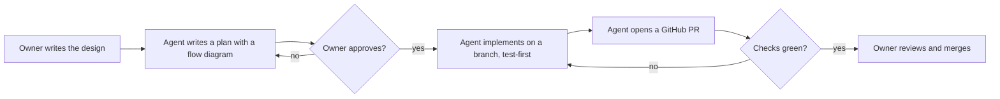

# Workflow

How work is done in this repo: how a request flows from design to merge, what a change must update in the docs, the checks a change must pass, and the hooks that gate agents.

## The flow

The owner designs and reviews; agents plan and implement to the design.

1. **Design.** The owner writes the design note in `docs/design/`. An agent may answer questions about it or list options, but does not write or change a design note unless the owner asks.
2. **Plan.** The agent classifies the request and says which path it chose:
   - *spike*: a feasibility question. The answer is a recommendation, and any code is throwaway.
   - *bounded*: a small change to an existing flow. A short plan in chat, then implementation after the owner says yes.
   - *feature*: new components, or changes to how parts fit together. A written plan in `docs/plans/` that the owner reviews before any code.

   Every plan for a bounded change or a feature has a flow diagram: a mermaid `flowchart` or `sequenceDiagram` of the requests, data or steps the change adds, so the owner can check the shape before reading code. A long plan can also be rendered as a lavish page (a reviewable HTML page the owner annotates); `.lavish/` is gitignored. A plan lists the files it will touch, the tests it will add, and every open question for the owner.
3. **Implement.** One task per branch, off `main`. Tests first: a failing test that states the behaviour, then the code. Keep each commit small enough to read on its own.
4. **Pull request.** Push the branch and open a pull request into `main` with `gh pr create`. The body says what changed and why, links the design note and the plan, and names anything the owner should look at closely. Watch `gh pr checks` and fix failures on the branch. Never push to `main` and never merge: the owner does.

A plan's checkboxes are not status: agents do not reliably tick them. Status lives in GitHub issues and in git. A finished or withdrawn plan is removed; git history keeps it.

## Documentation in each change

- Pick the page by subject: the component's page, or a module's docstring.
- Change the page in the same PR as the behaviour. A module's rules live in its docstring, which the page links, so edit the docstring, not a copy.
- What is left goes in an issue, not a page.
- No secrets, tokens, private paths or personal details in docs. The repo is public.

Code and prose follow [Style](Style.md).

## Checks

[`.github/workflows/checks.yml`](../.github/workflows/checks.yml) runs on every pull request and push to `main` (a draft PR runs nothing until marked ready). Its jobs run on GitHub's hosted runners:

- `checks`: `uv sync --locked`, `ruff check`, `ruff format --check`, `mypy` and `pytest -rs --cov`, which lists skipped tests and fails below the `fail_under` floor in `pyproject.toml`.
- `gitleaks`: every commit of the history. `.gitleaksignore` lists, by fingerprint, the findings that are not secrets.

Run the checks locally in the same change. `uv run pre-commit install` runs them as git hooks from `.pre-commit-config.yaml`: on a commit gitleaks on the staged changes, `uv lock --check`, ruff and mypy; on a push pytest. `uv run pre-commit run --all-files --hook-stage pre-push` runs them all by hand.

Each action is pinned to a commit; Dependabot (`.github/dependabot.yml`) proposes weekly bumps of the actions and `uv.lock`, at least a week old. The gitleaks image and the gitleaks hook rev are bumped by hand.

## Agent gates

Two hooks in `.claude/settings.json` (scripts in `.claude/hooks/`, tests in `tests/test_agent_hooks.py`) run before each Bash call of a Claude Code session in this repo and block it with a reason the agent reads. They bind agents only and are advisory, like red CI: nothing stops a person's merge. They parse the command with `shlex`, after dropping comments and heredoc bodies, so a chain such as `a && git commit -n` is caught.

- `no-verify` blocks `git commit`, `push` and `merge` with `--no-verify`, and `commit -n`.
- `merge-on-red` blocks `gh pr merge` unless every check completed and passed, naming the others. No checks, a `gh` error, or a `cd` or `GH_REPO` in the same command also block. It does not wait for pending checks.

Not caught: `bash -c "..."` and `$(...)`, `SKIP=... git push` and `git -c core.hooksPath=...`.
